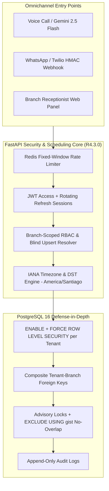

# AgendaVoice AI (R4.3.0) — Multi-Tenant & Multi-Branch Omnichannel Scheduling Engine

An enterprise B2B SaaS scheduling and conversational booking platform built with **FastAPI**, **PostgreSQL 16 (`FORCE ROW LEVEL SECURITY` + `btree_gist`)**, **Redis 7**, **Google Gemini 2.5 Flash**, and **React + TypeScript**.

Engineered to enforce strict **tenant isolation** between companies and **branch-level operational privacy** within the same company, while enabling frictionless phone, voice AI, and WhatsApp bookings via an industry-standard **Blind Upsert** workflow.

> **Interactive Architecture Showcase & Live Simulator (GitHub Pages):** Open [`docs/index.html`](docs/index.html) locally or enable **GitHub Pages** (`Settings > Pages > Branch: main /docs`) for interactive SVG diagrams, security matrices, and a live multi-branch simulator.
> **Full Technical Documentation Index:** See [`docs/README.md`](docs/README.md).

---

## System Architecture & Two-Ring Isolation



### Core Engineering Highlights

1. **Ring 1 — Database-Enforced Tenant Isolation (`FORCE RLS` + Composite FKs):**
   * Every tenant-scoped table (`tenants`, `users`, `branches`, `customers`, `services`, `staff`, `resources`, `appointments`, `refresh_sessions`, `user_branch_access`, `audit_logs`, and all 6 schedule/break tables) enforces `ENABLE ROW LEVEL SECURITY` and `FORCE ROW LEVEL SECURITY` bound to `current_setting('app.tenant_id', true)`.
   * SQLAlchemy's `Session.after_begin` listener reapplies `app.tenant_id` on every transaction boundary, preventing connection pool leakage after `COMMIT`.
2. **Ring 2 — Intra-Tenant Branch Privacy & Industry-Standard "Blind Upsert":**
   * Branch-scoped roles (`BRANCH_MANAGER`, `OPERATOR`, `READ_ONLY`) can only view schedules, staff, resources, and appointments belonging to their assigned `branch_id`s in `user_branch_access`.
   * **Customer Scope (`home_branch_id` + Visit History):** `GET /customers` only returns customers registered at or previously booked in the user's allowed branches.
   * **Cross-Branch Phone Booking ("Blind Upsert"):** When an existing customer from Branch A calls or messages Branch B, `POST /customers/resolve-phone` and `POST /appointments` link the customer by exact normalized phone number (`+569...`) **without exposing Branch A's history or metadata** and without requiring administrator intervention.
3. **Physical Concurrency Guarantees (`btree_gist`):**
   * Combines ordered transaction-level `pg_advisory_xact_lock` with PostgreSQL `EXCLUDE USING gist (tenant_id WITH =, staff_id WITH =, tstzrange(starts_at, ends_at, '[)') WITH &&)` constraints so two concurrent requests can never double-book a professional or physical resource.
4. **Omnichannel Voice & WhatsApp AI Agent (`app/integrations/`):**
   * Scopes **Gemini 2.5 Flash** (`agent.py`) strictly to the target `branch_id` and validates incoming WhatsApp/Voice webhooks via cryptographic `X-Twilio-Signature` HMAC-SHA1 verification (`webhooks.py`).

---

## Role & Branch Permission Matrix

| Role | Scope | Branches & Schedules | Staff & Resources | Customers (`GET /customers`) | Cross-Branch Phone Booking | Audit Logs |
| :--- | :--- | :--- | :--- | :--- | :--- | :--- |
| **`SUPER_ADMIN`** | Tenant-wide | Full CRUD | Full CRUD | All tenant customers | Unrestricted | Read (`GET /audit-logs`) |
| **`TENANT_ADMIN`** | Tenant-wide | Full CRUD | Full CRUD | All tenant customers | Unrestricted | Read (`GET /audit-logs`) |
| **`BRANCH_MANAGER`** | Assigned `branch_ids` | Read + Update own branch schedule | CRUD in own branch | Only own branch (origin or visited) | Yes (via exact phone Blind Upsert) | Denied (`403`) |
| **`OPERATOR`** | Assigned `branch_ids` | Read own branch schedule | Read own branch | Only own branch (origin or visited) | Yes (via exact phone Blind Upsert) | Denied (`403`) |
| **`READ_ONLY`** | Assigned `branch_ids` | Read own branch schedule | Read own branch | Only own branch (origin or visited) | Denied (`403` on write) | Denied (`403`) |

---

## Step-by-Step Tutorial (Local Setup & Verification)

### 1. Start the Full Stack with Docker Compose

```bash
cp .env.example .env
# Edit .env to set a strong JWT_SECRET (minimum 32 characters) and optional GEMINI_API_KEY
docker compose up -d --build
```

* **Backend REST API:** `http://localhost:8000`
* **Interactive Swagger UI:** `http://localhost:8000/docs`
* **React Admin Console:** `http://localhost:5173`

### 2. Run the Automated Test Suites

```bash
# Run pure unit test suites (24 tests: customer scope, DST policy, omnichannel & blind upsert)
cd backend
PYTHONPATH=. python3 tests/test_customer_scope_r422.py
PYTHONPATH=. python3 tests/test_dst_policy_r421.py
PYTHONPATH=. python3 tests/test_omnichannel_r430.py

# Run full pytest suite + live PostgreSQL RLS & concurrency verification
cd ..
./scripts/test-postgres-rls-compose.sh
```

### 3. Walkthrough: Multi-Branch Isolation & Blind Upsert via API

1. **Register a Company (`POST /auth/register`):** Creates the tenant, `TENANT_ADMIN` user, and returns `access_token` + `refresh_token`.
2. **Create Two Branches (`POST /branches`):** Create *"Sucursal Las Condes"* (`id=1`) and *"Sucursal Providencia"* (`id=2`).
3. **Configure 7-Day Branch Schedule (`PUT /branches/1/schedule` & `PUT /branches/2/schedule`):** Define local opening/closing hours (`09:00:00` to `18:00:00`) and lunch breaks in `America/Santiago`.
4. **Assign Branch Operator (`POST /users`):** Create an `OPERATOR` assigned exclusively to `branch_ids: [2]` (Providencia).
5. **Book by Phone across Branches (`POST /appointments`):** Using the Providencia operator token, submit `customer_phone: "+56912345678"` and `customer_name: "Carlos Méndez"`. Even if Carlos was originally registered in Las Condes (`branch_id=1`), the Blind Upsert links his record cleanly for the Providencia appointment without leaking his Las Condes history.

---

## License

Released under the [MIT License](LICENSE) — Copyright (c) 2026 **Pedro Stephen Lulion Pasten / Webfinanzas Corp.**
